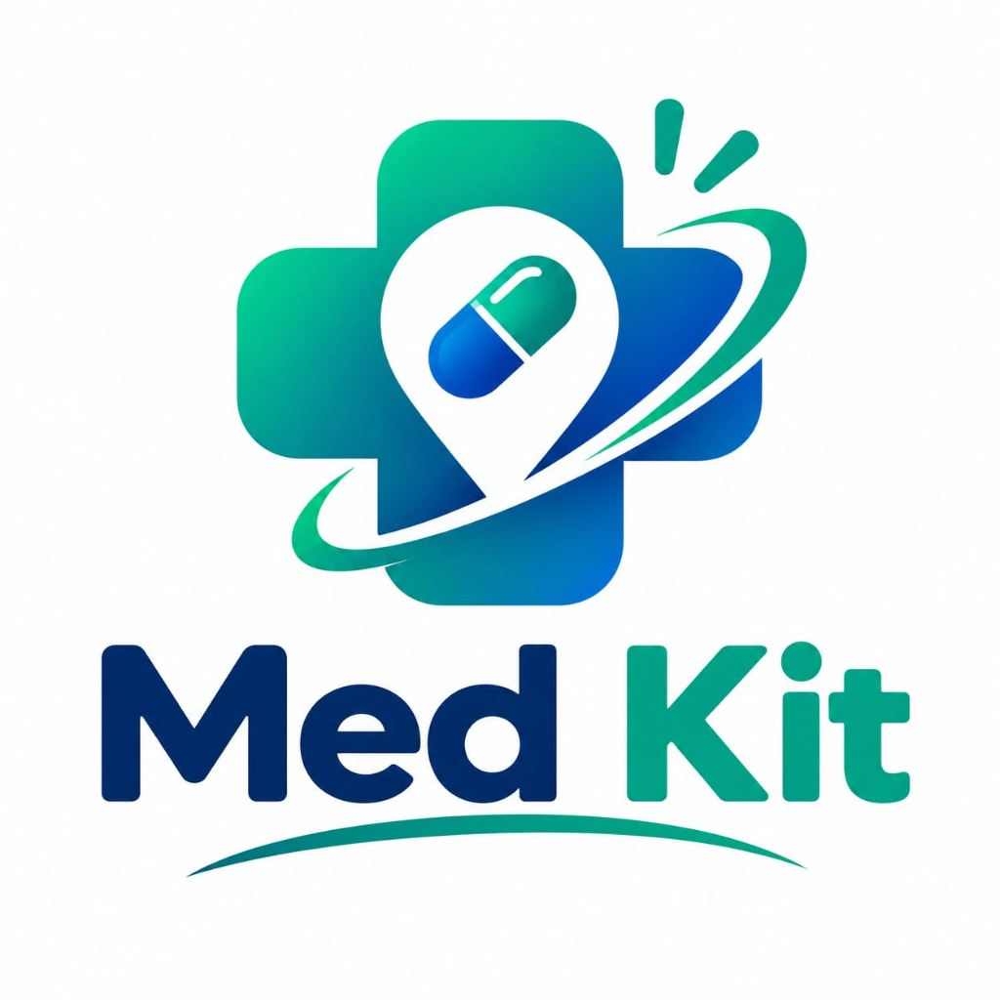
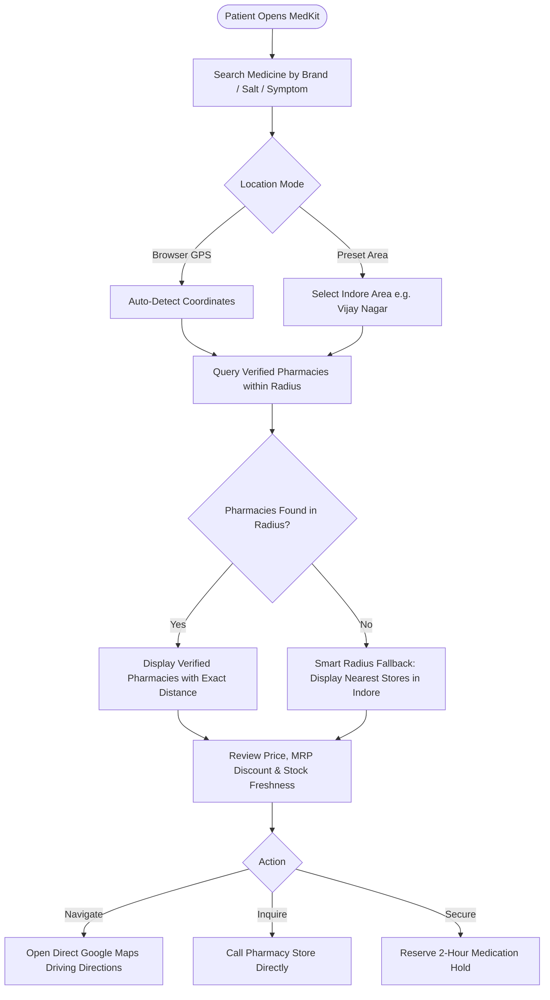
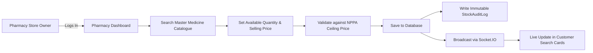
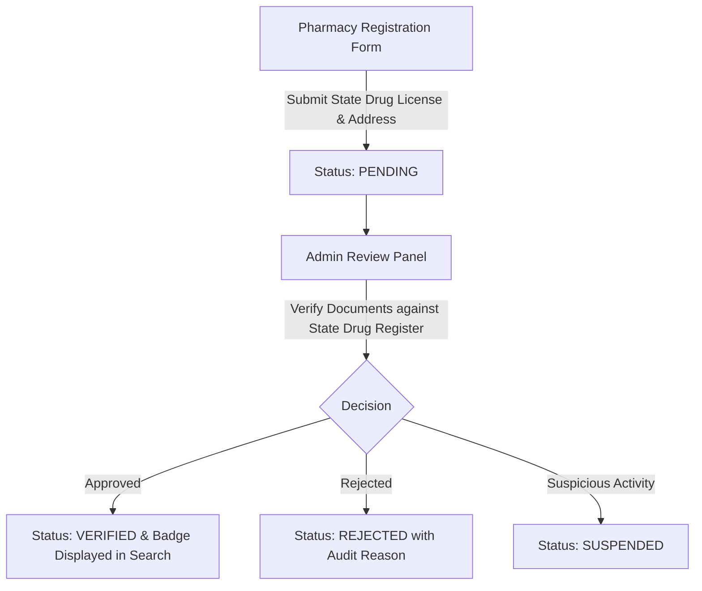
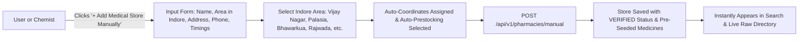

# MedKit — Medicine Availability & Nearby Pharmacy Discovery Platform

<div align="center">
  
  <h3>Find Your Medicine. Discover Verified Nearby Pharmacies.</h3>
  <p>A production-ready full-stack healthcare discovery platform connecting patients, licensed local pharmacies, and administrators.</p>
</div>

---

## 📌 Overview

**MedKit** is an AI-powered medicine availability and pharmacy discovery platform designed to solve the problem of medicine stock uncertainty. When a patient needs a critical medicine (e.g. *Dolo 650*, *Augmentin 625*, *Asthalin Inhaler*), MedKit locates verified licensed medical stores within an exact geographic radius (2 km to 20 km), shows real-time stock availability, compares listed prices against NPPA government caps, and allows instant 2-hour hold reservations.

Primary launch focus: **Indore, Madhya Pradesh** (covering Vijay Nagar, Old Palasia, 56 Dukan, Bhawarkua, Geeta Bhawan, Annapurna Road, MR-10/Bapat Square, and Rajwada), with multi-city expansion ready.

---

## 🏗️ Architecture & Workflows

### 1. Customer Medicine Discovery Flow


### 2. Real-Time Pharmacy Inventory & Pricing Flow


### 3. Role-Based Security & Regulatory Approval Flow


### 4. Manual Medical Store Onboarding & Instant Verification Flow


---

## 💻 Tech Stack

### Frontend (`apps/web`)
- **Framework:** Next.js 14 (App Router)
- **Language:** TypeScript (Strict Mode)
- **Styling:** Tailwind CSS, PostCSS
- **State & Data Fetching:** TanStack Query v5, Context API
- **Icons & Animation:** Lucide React, Framer Motion
- **Real-Time Client:** Socket.IO Client v4
- **Forms & Validation:** React Hook Form, Zod

### Backend (`apps/api`)
- **Runtime:** Node.js, Express.js
- **Language:** TypeScript, TSX
- **ORM & Database:** Prisma ORM with SQLite (Development) / PostgreSQL (Production)
- **Authentication:** JWT with secure Bearer authorization & HTTP-Only cookies
- **Security:** Helmet, CORS, Cookie-Parser, BcryptJS password hashing
- **Real-Time Server:** Socket.IO v4 (Live stock sync)
- **Geospatial Engine:** High-performance Haversine Great-Circle distance formula

---

## 📁 Project Structure

```text
medkit/
├── apps/
│   ├── api/                           # Express.js REST API & WebSocket Server
│   │   ├── prisma/
│   │   │   ├── schema.prisma          # SQLite schema (Development)
│   │   │   ├── schema.postgresql.prisma # PostgreSQL / Neon schema (Production)
│   │   │   └── seed.ts                # Database seed with 10 Indore pharmacies & 20 medicines
│   │   └── src/
│   │       ├── config/                # Environment configuration
│   │       ├── controllers/           # Auth, Medicine, Pharmacy, Inventory, Admin controllers
│   │       ├── middleware/            # JWT authentication, role verification, error handlers
│   │       ├── routes/                # REST API route handlers
│   │       ├── services/              # Socket.IO broadcasting services
│   │       ├── shared.ts              # Inlined shared types, Haversine & freshness math
│   │       └── server.ts              # Express HTTP & Socket.IO server entry point
│   │
│   └── web/                           # Next.js 14 Web Application
│       ├── public/
│       │   └── logo.png               # Official MedKit brand logo
│       └── src/
│           ├── app/
│           │   ├── page.tsx           # Premium Home Page with reference UI styling
│           │   ├── search/page.tsx    # Medicine search, filters, nearby pharmacy cards
│           │   ├── medicines/[id]/    # Medicine details & live availability
│           │   ├── pharmacies/[id]/   # Pharmacy store public profile
│           │   ├── pharmacy/dashboard # Inventory & pricing management for chemist owners
│           │   ├── admin/dashboard/   # Administrator verification & catalogue panel
│           │   ├── login/page.tsx     # 1-Click fast demo authentication
│           │   └── register/page.tsx  # Customer registration
│           ├── components/            # Navbar, Footer, Cards, Badges, Modals
│           ├── context/               # AuthContext, LocationContext, QueryProvider
│           ├── lib/                   # API client fetcher & Socket.IO client singleton
│           └── types/                 # Shared TypeScript interfaces
├── .env.example                       # Documented environment template
├── .gitignore
├── package.json                       # Monorepo root scripts
└── README.md
```

---

## 🚀 Quick Start Guide

### Prerequisites
- **Node.js:** v18.17+ or v20+
- **npm:** v9+ or v10+

### 1. Clone the Repository
```bash
git clone https://github.com/aryansoni70/medkit.git
cd medkit
```

### 2. Install Dependencies
```bash
# Install Backend dependencies
cd apps/api
npm install

# Install Frontend dependencies
cd ../web
npm install
```

### 3. Initialize & Seed Database
```bash
cd ../api

# Generate Prisma Client and sync SQLite database
npx prisma generate
npx prisma db push

# Seed 10 Indore pharmacies, 20 medicines, 78 inventory records, and test users
npx tsx prisma/seed.ts
```

### 4. Run Development Servers
Open two terminal windows:

**Terminal 1 — Backend API Server (Port 5000):**
```bash
cd apps/api
npm run dev
```

**Terminal 2 — Frontend Application (Port 3000):**
```bash
cd apps/web
npm run dev
```

Visit **[http://localhost:3000](http://localhost:3000)** in your browser.

---

## 🔑 Demo Login Accounts

| Role | Email | Password | Access / Purpose |
| :--- | :--- | :--- | :--- |
| **Customer** | `customer@medkit.in` | `password123` | Search medicines, check availability, 2-hr holds |
| **Pharmacy Owner (Indore)** | `apollo.vijaynagar@medkit.in` | `password123` | Pharmacy Dashboard at `/pharmacy/dashboard` |
| **Administrator** | `admin@medkit.in` | `admin123` | Admin Panel at `/admin/dashboard` |

*(Note: On the [Login Page](http://localhost:3000/login), you can click any of the **1-Click Demo Login** buttons to authenticate instantly.)*

---

## 📍 Covered Localities in Indore

The platform is pre-loaded with verified pharmacies across key Indore regions:
- **Vijay Nagar** (Scheme 54, Near Brilliant Convention Centre)
- **Old Palasia** (Industry House Complex, A.B. Road)
- **New Palasia** (Near Chhappan Dukan / 56 Dukan)
- **Bhawarkua** (Tower Square, Bhawarkua Main Road)
- **Chhoti Gwaltoli** (Dawa Bazar Complex, R.N.T. Marg)
- **Geeta Bhawan** (Geeta Bhawan Square, A.B. Road)
- **Annapurna Road** (Opp. Dussehra Maidan)
- **MR-10 & Sukhlia** (Near Bapat Square)
- **Rajwada** (M.G. Road, Near Rajwada Palace & Sarafa)
- **Sudama Nagar** (Sector E, Footi Kothi)

---

## 📡 REST API Reference

| Method | Endpoint | Description | Auth Required |
| :--- | :--- | :--- | :--- |
| `GET` | `/api/v1/health` | Service health status | No |
| `POST` | `/api/v1/auth/register` | Register customer or pharmacy account | No |
| `POST` | `/api/v1/auth/login` | Login with email & password | No |
| `GET` | `/api/v1/auth/me` | Fetch authenticated session | Yes (Bearer) |
| `GET` | `/api/v1/medicines` | Search medicines with pagination & filters | No |
| `GET` | `/api/v1/medicines/suggest` | Autocomplete medicine search query | No |
| `GET` | `/api/v1/medicines/:id` | Get single medicine details & pharmacies | No |
| `GET` | `/api/v1/pharmacies/all` | Get full raw directory of all verified medical stores | No |
| `POST`| `/api/v1/pharmacies/manual` | Manually add and instantly verify an Indore medical store | No |
| `GET` | `/api/v1/pharmacies/nearby` | Haversine nearby pharmacies search | No |
| `GET` | `/api/v1/pharmacies/:id` | Public pharmacy profile & stock list | No |
| `POST` | `/api/v1/pharmacies/register` | Submit pharmacy onboarding application | Yes |
| `GET` | `/api/v1/inventory/pharmacy/me`| Chemist's own listed inventory | Yes (PHARMACY) |
| `POST` | `/api/v1/inventory` | Add/Update medicine price & quantity | Yes (PHARMACY) |
| `GET` | `/api/v1/admin/dashboard` | System KPI statistics | Yes (ADMIN) |
| `PATCH`| `/api/v1/admin/pharmacies/:id/verification` | Approve/Reject pharmacy license | Yes (ADMIN) |

---

## ⚖️ Statutory Medical & Regulatory Notice

**MedKit** is an information and nearby pharmacy discovery platform. MedKit is **not an online pharmacy**, does not dispense or distribute medicines directly, and does not provide medical consultations or recommend therapeutic drug substitutions. 

All prescription medications (Schedule H / Schedule H1 under the Indian Drugs & Cosmetics Act) require verification of an original physical prescription by a licensed pharmacist at the dispensing retail pharmacy. Listed selling prices are compared with the National Pharmaceutical Pricing Authority (NPPA) ceiling prices.

---

## 📄 License
This project is licensed under the MIT License — see the [LICENSE](LICENSE) file for details.
